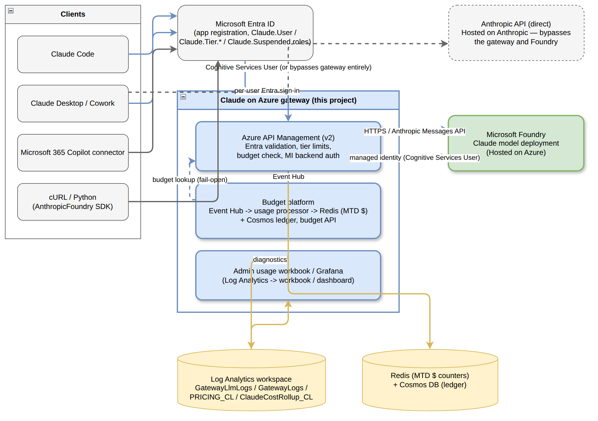

# Claude Foundry APIM Gateway

An enterprise gateway for **Claude models in Microsoft Foundry**, built on **Azure API Management**.
Users sign in with **Microsoft Entra ID**; the gateway checks their role, applies per-user and per-team
limits and monthly budgets, and records usage per developer and team in **Log Analytics**.
It works with **Claude Code** (CLI and VS Code) and **Claude Desktop**.



## Start here

| Step | Document | For |
|---|---|---|
| 1 | [Prerequisites checklist](docs/01-prerequisites-checklist.md) | Customer admins, before the deployment |
| 2 | [Admin deployment guide: Linux / Bash](docs/02-admin-deployment-guide-linux.md) (recommended) or [Windows / PowerShell](docs/03-admin-deployment-guide-windows.md) | Platform admin |
| 3 | [Developer onboarding guide](docs/04-developer-onboarding-guide.md) | Developers |
| 4 | [Operations guide](docs/05-operations-guide.md) | Platform admin: teams, budgets, monitoring, troubleshooting, clean-up |

The full reading order is in [docs/README.md](docs/README.md).

## How it works

| Component | Role |
|---|---|
| Azure API Management (Standard v2) | Gateway endpoint. Validates Entra access tokens and the `Claude.User` role, applies per-user and per-team token limits and model access, checks budget state, and calls Foundry with its managed identity. |
| Microsoft Foundry | Hosts the Claude Opus, Sonnet and Haiku deployments |
| Event Hubs + usage processor (Azure Functions) | Receives usage events from the gateway, prices them and updates spend |
| Budget API (Azure Functions) + Redis + Cosmos DB | Answers "is this user or team within budget?" for the gateway; keeps durable budget state |
| Log Analytics + workbooks (optional Grafana) | Usage and cost per developer and team |
| Microsoft Entra ID | Gateway API app with roles (`Claude.User`, tier, team and profile roles), Claude Desktop client app, one security group per team |

**Limits:**
- **Per-user tiers** `pro`, `basic`, `lite`: tokens per minute, monthly tokens and monthly USD.
- **Team profiles** (for example `regular`, `power`): shared limits and a monthly budget for a team.
- **Team governance mode** (default `enforce`): every user must be in exactly one team, and each team can use only its allowed models. `observe` logs team identity problems without blocking.
- **Suspension**: the `Claude.Suspended` role blocks a user.

## Repository layout

```
admin/       Administrator setup scripts (Bash and PowerShell), configuration example and validation
developer/   Developer workstation setup scripts (Bash and PowerShell) and the client field reference
infra/       Bicep templates, APIM policy, workbooks and Grafana dashboard deployed by the setup
snippets/    Function code (usage processor, budget API), pricing loader, cost reconciler, test scripts
docs/        Customer guides and architecture diagrams
tests/       Regression tests for the pricing and processor arithmetic
```

Reference material for advanced use:
- [admin/README.md](admin/README.md): every configuration field, permissions, optional stages and governance operations
- [infra/README.md](infra/README.md): template-by-template details and manual deployment order
- [developer/README.md](developer/README.md): developer script options

## Requirements in brief

- Azure subscription with permission to deploy resources **and** role assignments
- Entra rights to create app registrations, app roles and security groups
- An existing Microsoft Foundry resource with one Claude Opus, Sonnet and Haiku deployment each
- A Linux shell (recommended) or Windows with PowerShell 7.3+, with Azure CLI, Bicep, `jq`, Python 3 and Azure Functions Core Tools v4

The [prerequisites checklist](docs/01-prerequisites-checklist.md) has the full list and checks.

## Known limitations

- **Budgets are partial-cost limits, not exact dollar ceilings.** The usage processor counts uncached input, output and cache-read tokens; **cache-write tokens are not counted**, so recorded spend can be lower than the actual Foundry cost. Treat budgets as guardrails and reconcile against Azure cost reporting. See [CACHE-TOKEN-ANALYSIS.md](CACHE-TOKEN-ANALYSIS.md).
- **Budget accounting is asynchronous and fail-open.** Spend is counted shortly after each request, so a user can go slightly over a limit before it is enforced; if the budget service is unavailable, requests are allowed.
- **Prices are maintained in [`snippets/15-load-pricing.py`](snippets/15-load-pricing.py).** Review them against your Azure agreement before deployment.
- **Validate enforce-mode denials in your environment** (allowed and disallowed model, user without a team) before rollout; the operations guide lists the checks and the `x-claude-denied-by` reasons.
- The setup is additive: it never deletes resources, removes group members or role assignments, or requests quota.

## Security

Never put passwords, API keys, tokens or client secrets in any configuration file.
Do not commit environment-specific files: `admin/setup.local.json`, `admin/setup.rejected.json`,
`developer/claude-client-configuration.json` and `logs/` (they are listed in `.gitignore`).

## Credits and license

Based on the *Claude on Azure* guide and code ([monuminu.github.io/claude-on-azure](https://monuminu.github.io/claude-on-azure/))
and [sombaner/claude-on-azure-sombaner](https://github.com/sombaner/claude-on-azure-sombaner).
This version adds customer deployment guides, Windows PowerShell fixes and configuration-validation fixes.

Content is licensed [CC BY 4.0](https://creativecommons.org/licenses/by/4.0/); code is licensed MIT. See [LICENSE](LICENSE).
